# Gym Management System (GMS)

## 📑 Table of Contents

- [📖 Project Overview](#project-overview)
- [🖼️ Screenshots](#screenshots)
- [✨ Key Features](#key-features)
- [🛠️ Technologies Used](#technologies-used)
- [🏗️ Project Structure](#project-structure)
- [🗄️ Database Design](#database-design)
- [🚀 Getting Started](#getting-started)
- [⚙️ Configuration](#configuration)
- [🔐 Usage](#usage)
- [👥 Team Members](#team-members)
- [🙏 Acknowledgments](#acknowledgments)

---

<a id="project-overview"></a>
## 📖 Project Overview

Gym Management System (GMS) is a Windows desktop application designed to organize and manage the essential operations of a gym through a centralized system.

The system provides dedicated modules for managing people, users, members, trainers, employees, classes, payments, and subscriptions, helping streamline daily administrative operations.

The application is built using C# and .NET Framework, following a Three-Tier Architecture that separates the Presentation Layer, Business Logic Layer, and Data Access Layer. It uses ADO.NET for database connectivity and Microsoft SQL Server for data storage.

This project was developed collaboratively by a team of three developers, focusing on practical software development, database design, object-oriented programming, layered architecture, and collaborative development using Git and GitHub.

---

<a id="screenshots"></a>
## 🖼️ Screenshots

<details>
<summary>Dashboard & Authentication</summary>

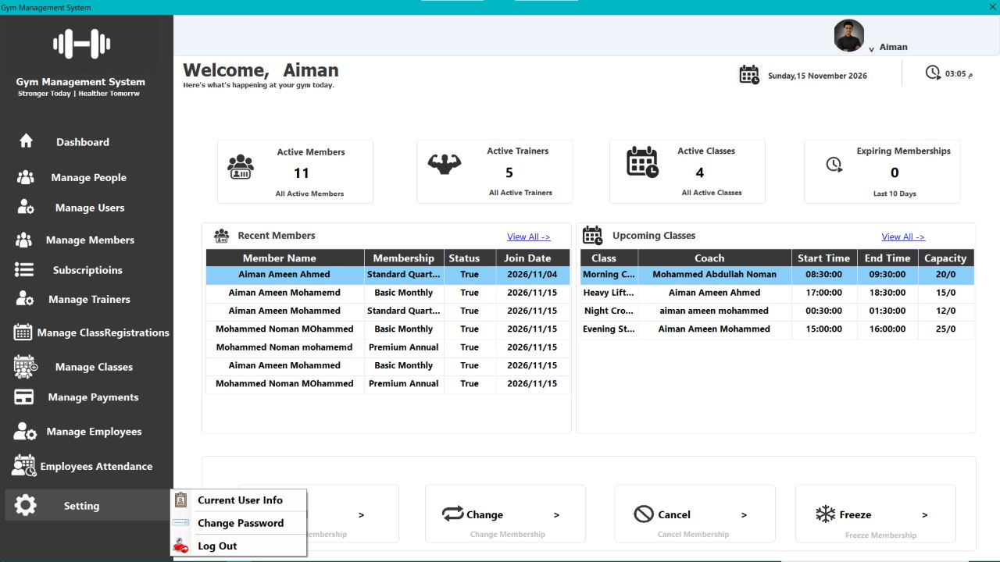

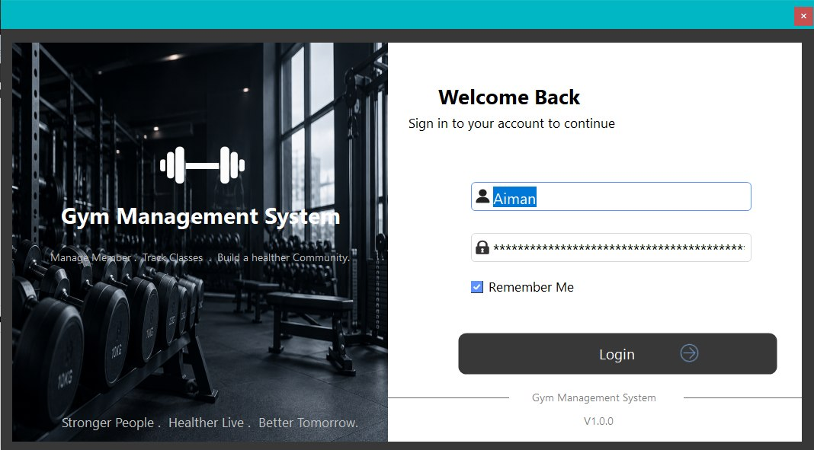

</details>

<details>
<summary>General Management</summary>

| People Management | Users Management |
|:---:|:---:|
| 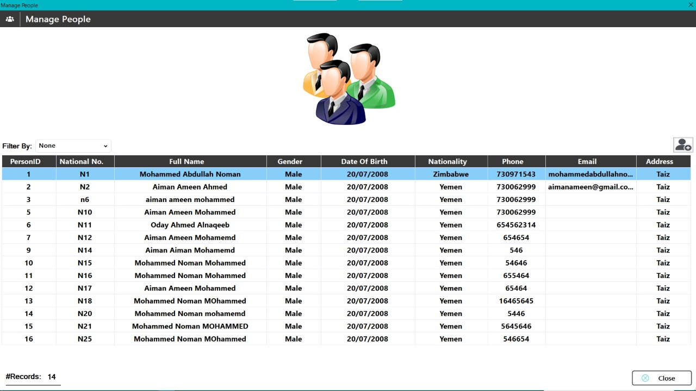 | 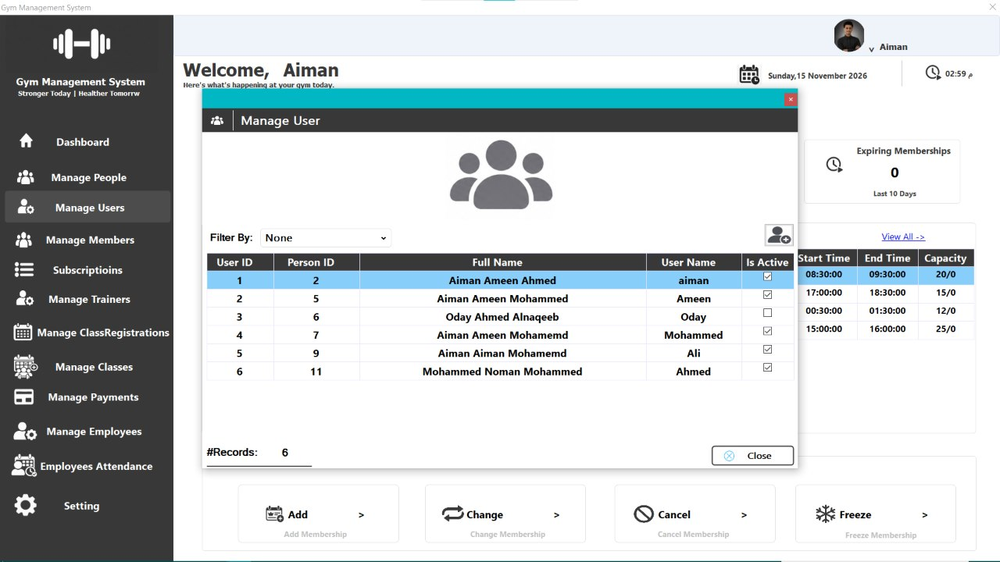 |

| Employees Management | Employee Attendance |
|:---:|:---:|
| 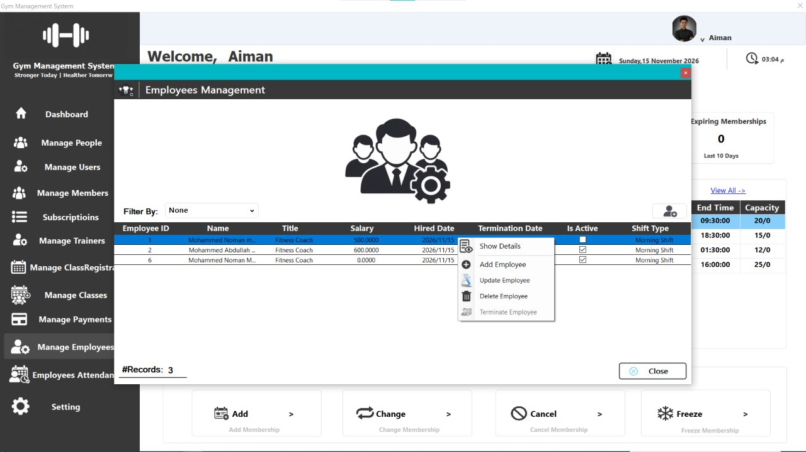 | 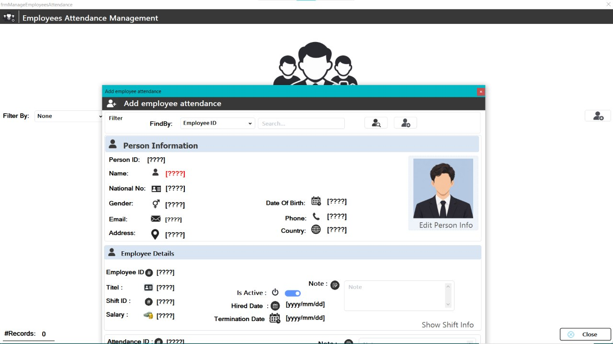 |

</details>

<details>
<summary>Gym Management</summary>

| Members Management | Trainers Management |
|:---:|:---:|
| 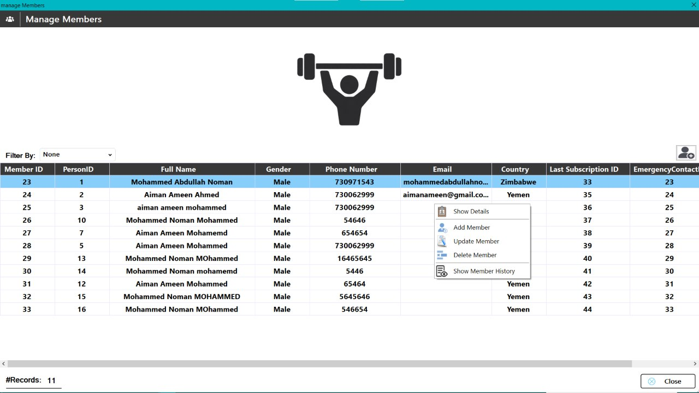 | 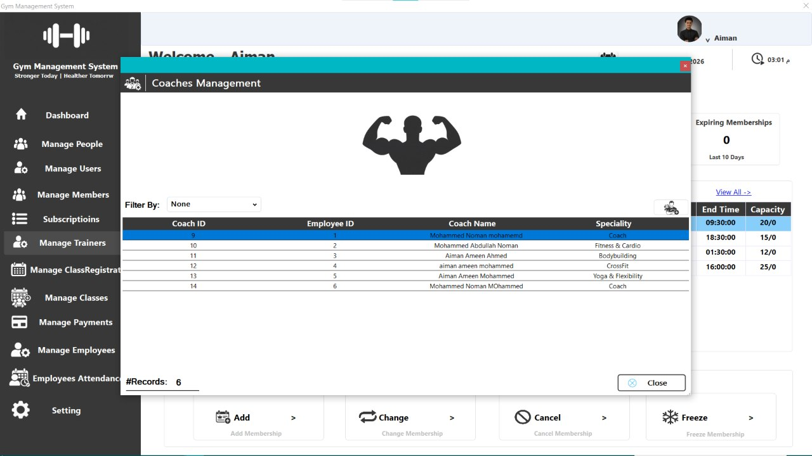 |

| Classes Management | Class Registration |
|:---:|:---:|
| 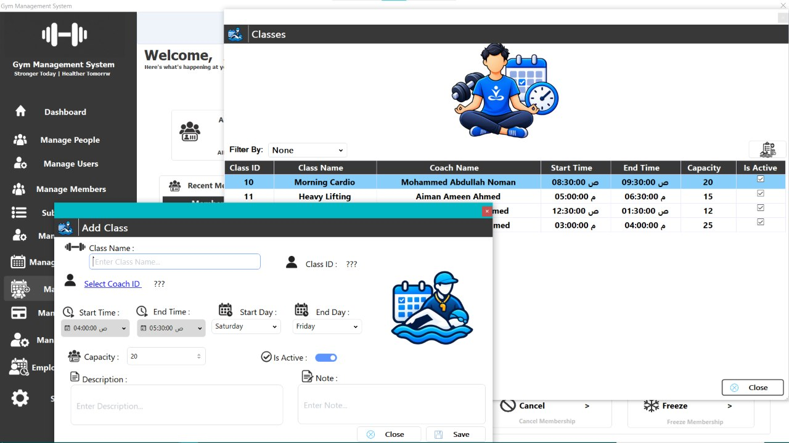 | 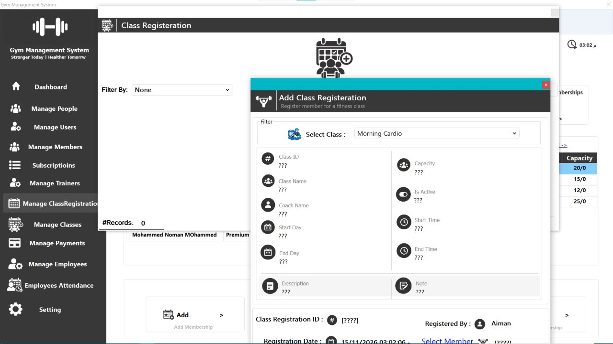 |

</details>

<details>
<summary>Subscriptions & Financial Management</summary>

| Subscriptions Management | Payments Management |
|:---:|:---:|
| 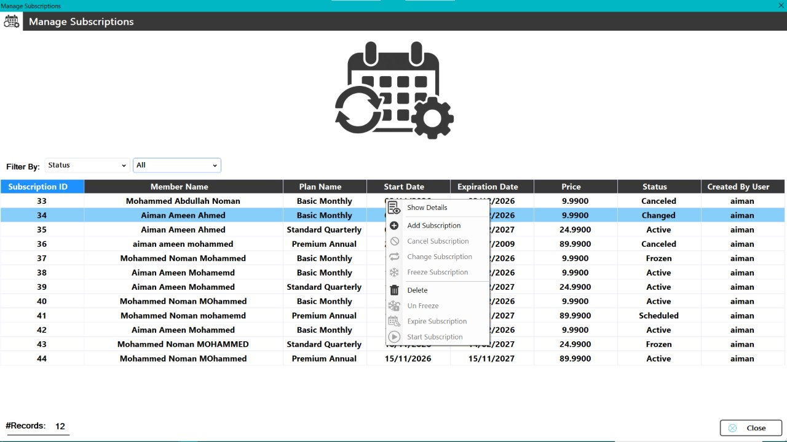 | 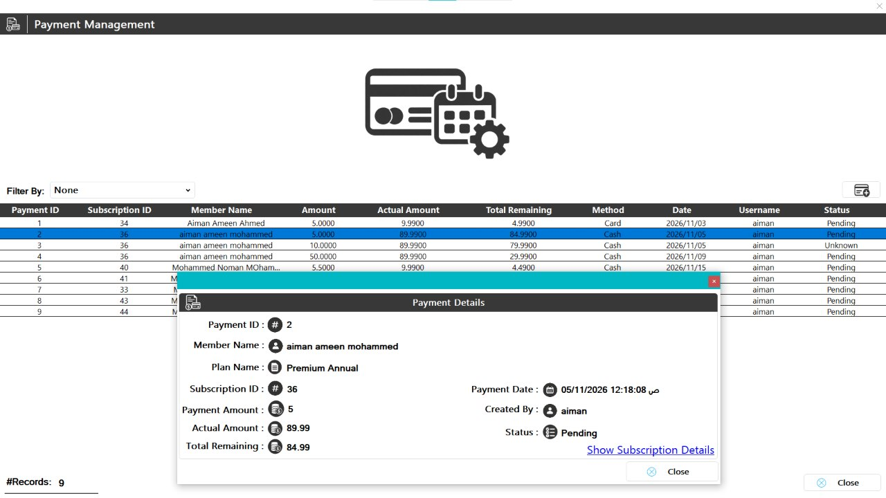 |

</details>

---

<a id="key-features"></a>
## ✨ Key Features

- **People Management:** Manage people records and personal information.
- **Users Management:** Manage system users and their access permissions.
- **Members Management:** Manage gym members and their information.
- **Subscription Management:** Manage member subscriptions, including activation, cancellation, freezing, expiration, and scheduling subscriptions.
- **Trainers Management:** Manage gym trainers and their information.
- **Classes Management:** Manage gym classes and their details.
- **Class Registration:** Manage members' registrations in gym classes.
- **Payments Management:** Manage subscription payments and payment records.
- **Employees Management:** Manage gym employees and their information.
- **Employee Attendance:** Track and manage employee attendance records.

---

<a id="technologies-used"></a>
## 🛠️ Technologies Used

| Technology | Purpose |
|---|---|
| C# | Main programming language |
| .NET Framework | Application development framework |
| Windows Forms | Desktop user interface development |
| ADO.NET | Database connectivity and data access |
| Microsoft SQL Server | Relational database management |
| SQL | Database queries and operations |
| Git | Version control |
| GitHub | Source code hosting and team collaboration |
| Visual Studio | Development environment |

---

<a id="project-structure"></a>
## 🏗️ Project Structure

The project follows a Three-Tier Architecture, organized into three main layers:

- **DataAccessLayer (DAL):** Responsible for database connectivity and data access operations.
- **DataBusinessLayer (BL):** Handles business logic and manages the interaction between the presentation and data access layers.
- **PresentationLayer (PL):** Contains the Windows Forms user interface through which users interact with the system.

---

<a id="database-design"></a>
## 🗄️ Database Design

The system uses Microsoft SQL Server as its relational database management system.

The database was designed from scratch to organize and maintain the information required by the system, ensuring structured data storage and relationships between different entities.

<details>
<summary>View Database Schema</summary>

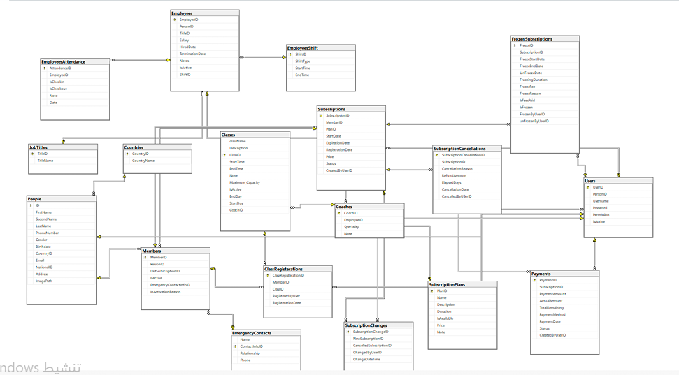

</details>

---

<a id="getting-started"></a>
## 🚀 Getting Started

Follow these steps to set up and run the Gym Management System locally.

### 📋 Prerequisites

Make sure you have the following installed:

- **Visual Studio:** To open, build, and run the project.
- **.NET Framework 4.8:** Required application framework.
- **Microsoft SQL Server:** Required for database storage and operations.

### 📥 Installation

1. Clone the repository:

   ```bash
   git clone https://github.com/alryqyashrf979-ux/GymManagementSystem.git
   ```

2. Open the solution file in Visual Studio.

3. Make sure the `GymManagementSystem` database is available on your SQL Server instance.

4. Update the database connection strings in `App.config` according to your local SQL Server configuration.

5. Build and run the application from Visual Studio.

---

<a id="configuration"></a>
## ⚙️ Configuration

The application uses SQL Server Authentication to connect to the database.

### Database Connection

The connection strings are defined in the `App.config` file located in the Presentation Layer.

Both the Business Logic Layer and the Data Access Layer retrieve the required connection strings from the Presentation Layer configuration.

Before running the application, make sure to update the connection strings according to your local SQL Server configuration.

The application uses the following connection strings:

| Connection String | Database |
|---|---|
| `ConnectionString` | `GymManagementSystem` |
| `MasterConn` | `master` |

Make sure SQL Server is running and the `GymManagementSystem` database is properly configured before launching the application.

---

<a id="usage"></a>
## 🔐 Usage

After successfully running the application, log in using the following default credentials:

| Field | Value |
|---|---|
| Username | `Admin` |
| Password | `123` |

---

<a id="team-members"></a>
## 👥 Team Members

This project was collaboratively developed by:

### 1. Ashraf Alariqi

- [LinkedIn](https://www.linkedin.com/in/اشرف-العريقي-48636435a)
- [GitHub](https://github.com/alryqyashrf979-ux)

### 2. Mohammed Noman

- [LinkedIn](https://www.linkedin.com/in/dev-moh-noman)
- [GitHub](https://github.com/mohammedabdullahnomanqaid-maker)

### 3. Aiman Ameen

- [LinkedIn](https://www.linkedin.com/in/aiman-ameen-2548673a8)
- [GitHub](https://github.com/aimanameenmohammed)

---

<a id="acknowledgments"></a>
## 🙏 Acknowledgments

We would like to express our sincere gratitude to:

- **[Dr. Mohammed Abu-Hadhoud](https://www.linkedin.com/in/abuhadhoud)** for his valuable educational content and guidance throughout the learning journey.

- **[Dr. Mohammed Aljaber](https://www.linkedin.com/in/mohammad-najeeb-aljaber-53a9239)** for his valuable contributions to our learning and for sharing his knowledge and experience.

Their efforts and educational contributions have played an important role in developing our technical skills and making this project a valuable practical learning experience.

---

## ⚖️ License

This project is licensed under the MIT License.

You are free to use, modify, distribute, and even sell this software, provided that the original copyright notice and license are included in all copies or substantial portions of the software.

See the [LICENSE](LICENSE) file for details.
